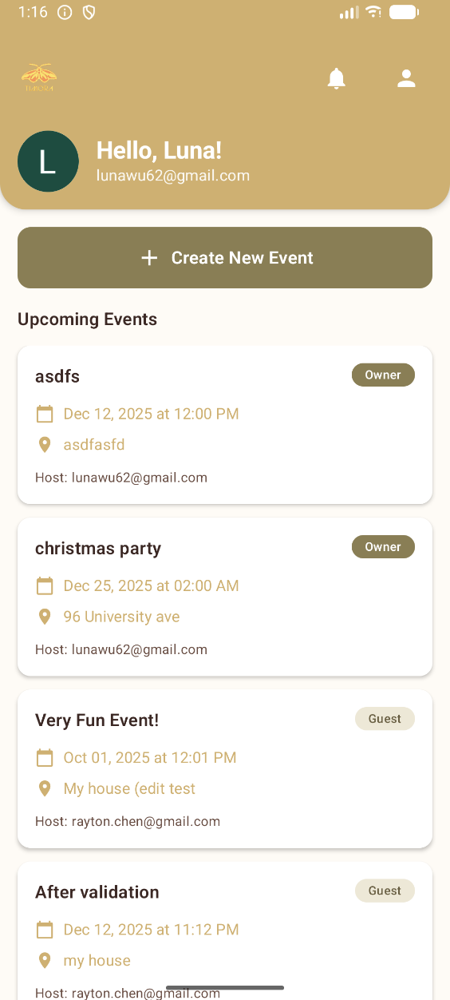
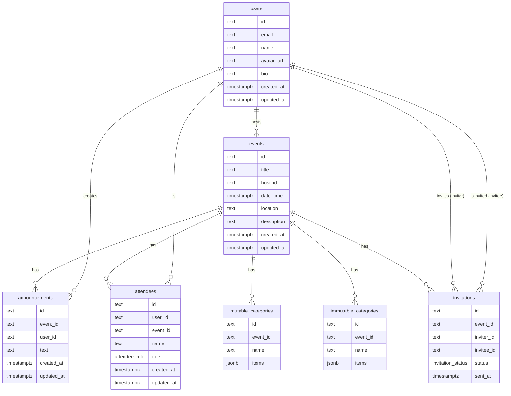
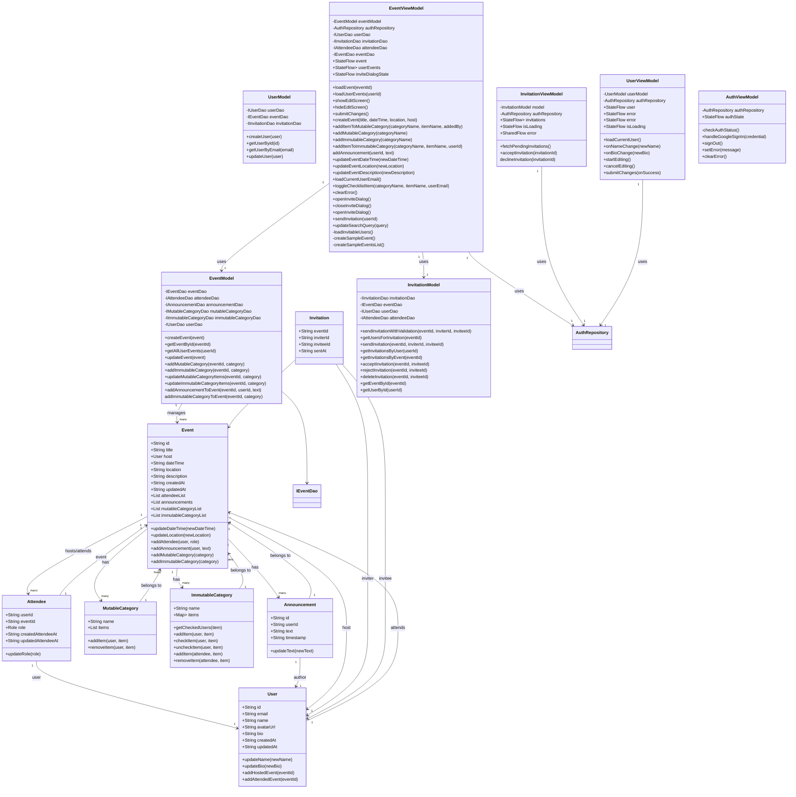

# Timora

An Android application designed for multiple users to plan a party, from pre to post-event details! See our [project proposal](https://git.uwaterloo.ca/hdhillon/timora/-/wikis/Proposal) for more details.

## Team 102-8

Hoyin Yong (h3yong@uwaterloo.ca)  
Luna Wu (l33wu@uwaterloo.ca)  
Harbin Dhillon (hdhillon@uwaterloo.ca)  
Rayton Chen (r379chen@uwaterloo.ca)  

## Team Contract

Our [team contract](https://git.uwaterloo.ca/hdhillon/test/-/wikis/Team-Contract) includes further details on how we will work together to create this mobile application.

We have [team meeting minutes](https://git.uwaterloo.ca/hdhillon/timora/-/wikis/Team-Meetings) after class on Wednesday and Friday where we meet and discuss project details.

## Main Screen
An image of the main screen of the application can be found 

## Demo Video
Walkthrough of our application and how it works can be found [here](https://youtu.be/wAK-_aJQzZE)

## Database ERD

## UML

## Getting Started

### Supported Platforms
- Android 11+
- The application runs on:
  - Android Emulator via Android Studio
  - Physical Android devices
---

### Installation Instructions

Before attempting to sign into this app, email your gmail to r379chen@uwaterloo.ca so I can allowlist your gmail in Google console.

#### 1. Set up an Android Virtual Device
If you do not already have an AVD:

1. Open **Android Studio**
2. Navigate to **Tools → Device Manager**
3. Click **Create Device**
4. Choose a phone profile (e.g., Pixel 5)
5. Finish setup and **launch** the emulator
6. **Go to Settings, and sign into your Google Account on this device**

---

#### 2. Download and Install the APK

1. Download the apk [here](https://git.uwaterloo.ca/hdhillon/timora/-/blob/main/AndroidApp/timora.apk)
2. Drag the APK file onto the running emulator window
3. It will automatically install
4. Open the app from the emulator’s app drawer

## Usage Guide

### 1. Google sign in
- Upon launching the app, you will see the Sign in with google button. Click to sign in.
    - You MUST have emailed me your gmail so I can allowlist your gmail in Google console.
    - You MUST have a working internet connection
    - You MUST be signed in to this virtual device with your Google Account
    - If any errors occur, try clicking the button again

### 2. Dashboard
- Once you sign in with your google account, you will be taken to the dashboard
- In the top right corner, from left to right, is the invitations button and the user profile button

### 3. Create event
- When you click on the **+ Create New Event** button on the dashboard, it will take you to the create event screen
- Required fields include event title, date (must be a valid date), time, and location
- Clicking **Creat Event** will add the event to the bottom of your dashboard under **Upcoming Events** with you (the creator) as the **Owner**

### 4. View / Edit event
- You will only be able to edit events for which you are the **Owner**
  - In the top right corner, from left to right, is the announcements, invite attendees, and edit event buttons
    - Clicking on the announcements button will take you to a modal where you can create and post announcements
    - Clicking on the invite attendees button will take you to a modal that displays a queriable list of all attendees in the database. Inviting an attendee will send them an invitation that they must either accept or decline
    - Clicking on the edit event button will take you to the edit event screen. Editable fields include date, time, location, description, categories, and wishlists. Clicking on **Submit Changes** will update the edited event details for all attendees. Clicking on the back arrow in the top left corner will discard your changes
      - Categories are lists where both owners and guests can add items
      - Wishlists are lists where only the owner can add items and guests can check them off
  - Clicking on the back arrow in the top left corner will take you back to the dashboard

### 5. View / Edit user profile
- Clicking on the person icon in the top right corner of the dashboard will take you to the user profile page
  - Clicking **Sign Out** will log you out of your google account and take you back to the google sign in page
- Clicking the the pencil icon in the top right corner of the user profile page will take you to the edit user profile page
  - Editable fields include full name and bio
  - Clicking the back arrow in the top left corner of the screen will take you back to the dashboard

### 6. Invitations
- Clicking on the bell icon in the top right corner of both the dashboard and the user profile page will take you to the view invitations page
- Pending invitations will appear in chronological order
  - If you click **Accept**, the event will be added to the bottom of your Upcoming Events with you as a **Guest**
  - If you click **Decline**, the invitation is dismissed

## Releases

- [Version 1.0 Release](https://git.uwaterloo.ca/hdhillon/timora/-/releases/1.0)
